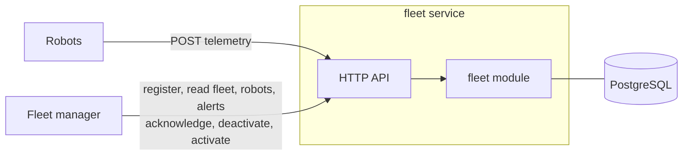

# Robot Fleet Management

[](https://github.com/mojtaba-gheytasi/robot-fleet-management/actions/workflows/ci.yml)

The server side of a fleet management system, in Go. Robots report a snapshot about once
per second; the service stores every snapshot, keeps each robot's current state, works out
battery health and connectivity, and tracks low-battery alerts that an operator can
acknowledge.

**Documents:** [PRD](./ROBOT_FLEET_PRD.md) (what it must do) ·
[Domain design](./ROBOT_FLEET_DOMAIN_DESIGN.md) (how the domain is modelled) ·
[Technical design](./ROBOT_FLEET_IMPLEMENTATION_PLAN.md) (tables, API, algorithms, tests)

## What I built and why

I built **only the server side**. The robot simulator and the UI are not built; a demo
script plays the robots and a fleet manager instead.

The server is where the hard rules of this problem live. Snapshots arrive late, twice, or
out of order, and the operator must still trust what they see. Battery health needs a
buffer so it does not flicker. Alerts must stay correct while a person acknowledges one
and the system resolves it at the same moment. A UI or a simulator would show these
rules; the server is where they can be wrong.



One bounded context (Fleet Management), one `fleet` module, one Go service, ports and
adapters. Registry, telemetry, health and alerts all talk about the same robot, so
splitting them would only add coordination.

## How robots report

Robots do not send events. While powered on, each robot sends the same snapshot about
once per second, and the system learns what happened from what changes, or from snapshots
stopping. Working this out decided most of the design:

| What happens to the robot | What the server sees | Result |
|---|---|---|
| Normal work | Snapshot every second | Current state updates; `ONLINE` |
| Battery drains below 20% | Battery value dropping | `LOW`; an alert opens with that snapshot |
| Put on the charger | `CHARGING`, battery rising | Alert resolves at 25% or more |
| Something breaks | Mode `ERROR` | Shown in its state; no alert |
| Turned off or lost network | Nothing | After 10 s without data: `STALE` |
| Resends after a lost response | Same observation ID | `duplicate`; nothing changes |
| Sends buffered snapshots late | Older observation time | Stored as `superseded`; state unchanged |
| Operator deactivates it | New snapshots keep coming | Rejected; its alert is closed |

## Design decisions and the failures they prevent

### 1. Two aggregates: Robot and Alert

An aggregate is what must stay correct together, so it is changed under one lock. Robot's
rules (accept telemetry only when active, apply only newer snapshots, the 20%/25% health
rule) need only robot data. Alert's rules (its status machine: open, acknowledge, resolve,
close; final states stay final; the fields and times always fit the status) need only alert
data. Both are methods on the aggregates; SQL only stores the result.

Putting alerts inside Robot would make an acknowledgement lock the robot, so an operator's
click and the robot's telemetry (every second) would wait for each other. An alert also has
its own ID and history: operators list and acknowledge alerts directly, and a robot has many
over its life. So the alert holds only the robot's ID.

One rule does need both: an active `LOW` robot has exactly one unresolved alert. The use
cases that change it (telemetry and deactivation) change the robot and its one unresolved
alert in the same transaction, robot lock first. See decision 3.

### 2. Late, repeated and concurrent snapshots never corrupt current state

Each snapshot is recorded under a per-robot row lock and ends as one of three outcomes:
`applied` (newer than the current one), `superseded` (older; kept in history only) or
`duplicate` (same ID and content; nothing changes). Same ID with different content is
`OBSERVATION_CONFLICT`. A concurrency test sends shuffled snapshots from many goroutines and
asserts that state never goes backwards. Reading the latest snapshot in the same statement
as the lock makes that test fail every time, which is why the read is a separate statement.

### 3. Every low-battery episode gets its own alert

After each applied snapshot, in the same transaction: if the robot is `LOW` and has no
unresolved alert, one opens; if it is no longer `LOW`, its alert resolves. Deactivation
closes it in its own transaction. Robot decides the health, Alert decides how it changes,
and the use case commits both or neither.

### 4. Battery health is stored; connectivity is computed

Battery health uses a buffer: `LOW` below 20%, back to `NORMAL` only at 25%. That needs
the previous value, so it is stored, and the row is written only when it changes, not
every second. Connectivity depends on the current time (`ONLINE` if the last applied
snapshot arrived within 10 s), so it is computed on every read and never stored.

### 5. Robot-side bugs fail loudly instead of corrupting data

Snapshots are ordered by the robot's own clock, so a time in the future is dangerous: once
applied, every real snapshot after it looks older and the robot's state freezes, silently.
A timezone bug, milliseconds read as seconds, or an unsynced clock can all cause this. A
snapshot more than 5 s ahead of the server is rejected with `CLOCK_SKEW_EXCEEDED`, so the
problem shows on the first bad message. A robot whose ID counter resets and reuses an ID
for new data gets `OBSERVATION_CONFLICT` instead of having real data dropped as a resend.

### 6. Acknowledging and resolving at the same moment loses neither

Acknowledging locks the alert row; a recovery snapshot locks the same row before it
resolves. If the resolution wins, the acknowledgement returns `ALERT_TERMINAL`; if the
acknowledgement wins, the resolution keeps it. Locks are always taken robot first, then
alert, so they cannot deadlock. Each use case reads the clock only after it holds its
locks, so an alert's times never run backwards; the domain and CHECK constraints reject it
if they would. Tests force each order with a clock that pauses one use case while it holds
its locks, and a race across 100 alerts checks the same rules under load.

### 7. Deactivation closes the alert in the same transaction

An inactive robot sends no telemetry, so its alert could never resolve. Deactivating
closes it at once with `ROBOT_DEACTIVATED` (not "recovered"). This changes two aggregates
in one transaction on purpose, because the alert is closed *by* the deactivation. After
reactivation, an alert opens only after a fresh low snapshot.

### 8. Finding a robot's current snapshot stays fast at any history size

One robot sends about 86,000 snapshots a day. Ingestion, the fleet list, robot details and
the summary all ask "what is this robot's newest applied snapshot?" in exactly this shape:

```sql
WHERE robot_id = $1 AND outcome = 'APPLIED' ORDER BY observed_at DESC LIMIT 1
```

A partial index on `(robot_id, observed_at DESC) WHERE outcome = 'APPLIED'` answers it with
a few page reads, the same at 30 thousand rows as at 30 million. `MAX(...)` or an `EXISTS`
on another column would look equivalent but walk the robot's history. An integration test
runs `EXPLAIN` on every such query and fails unless it uses the index.

## Run it

Requirements: Docker with Compose and `make`; Go 1.25 for the tests.

```bash
make up                # PostgreSQL, migrations and the service on 127.0.0.1:8080
make demo              # runs PRD workflows A–E and checks every answer (~15 s)
make test              # unit tests, with the race detector
make test-integration  # plus real PostgreSQL through testcontainers
make down
```

If port 8080 is taken, copy `.env.example` to `.env`, set `HTTP_PORT`, and run
`HTTP_PORT=… make demo`. Two sites are seeded: `site-north` and `site-south`.

| Method | Route | What it does |
|---|---|---|
| `POST` | `/api/robots` | Register a robot at a site; an identical retry is safe |
| `GET` | `/api/robots`, `/api/robots/{id}` | Fleet list (`?site_id=`) and one robot's current state |
| `POST` | `/api/robots/{id}/telemetry` | Report a snapshot: `applied`, `superseded` or `duplicate` |
| `GET` | `/api/robots/{id}/telemetry` | Recent history, each marked `APPLIED` or `SUPERSEDED` |
| `POST` | `/api/robots/{id}/deactivate`, `/activate` | Take a robot out of service and back |
| `GET` | `/api/fleet/summary` | Counts for the whole fleet or one site (`?site_id=`) |
| `GET` | `/api/alerts` | Every unresolved alert, or `?state=terminal` for recent history |
| `POST` | `/api/alerts/{id}/acknowledge` | Acknowledge an alert |
| `GET` | `/healthz`, `/readyz` | Liveness; readiness checks the database |

Error codes and payloads are in the [technical design](./ROBOT_FLEET_IMPLEMENTATION_PLAN.md#4-http-api-contract).

## The challenge questions

### What I faked or left out, and why that was the right trade

- **Robot simulator and UI.** `scripts/demo.sh` plays the robots and the fleet manager
  through the real API and checks every answer.
- **Authentication.** None, by choice for a local exercise.
- **Notifications.** An alert is a record with a lifecycle; nobody is paged.
- **One alert type.** Low battery only. `ERROR` mode is shown but raises no alert.
- **Sites** are seeded reference data; there is no site API.
- **Ordering trusts the robot's clock.** Simple and needs no extra protocol; a clock set
  backwards freezes that robot's state until it catches up.
- **Smaller limits:** the robot list and the unresolved-alert list have no paging (a robot
  has at most one unresolved alert); terminal alerts and history are capped at 200; robot
  IDs are 1–64 letters, digits, `-`, `_` or `.`, because they appear in URLs; unknown routes
  get Go's plain-text 404.

### What I would do differently with more time or in production

- **Security:** device credentials (mTLS) for robots; operator accounts and roles, and
  record *who* acknowledged an alert.
- **Ordering by sequence number:** a per-robot sequence number plus a boot ID, instead of
  the robot's clock.
- **Event messages next to snapshots** (docked, e-stop, shutting down), so "turned off" and
  "lost network" stop looking the same.
- **Notifications:** the transaction that opens an alert also writes an outbox row; a
  worker sends it and retries, so nothing is lost or sent twice.
- **More alert types:** connectivity lost, `ERROR` mode, and escalation of unacknowledged
  alerts. If alerting grows like this, it becomes its own module.
- **History at scale:** time-partitioned tables, retention and downsampling.
- **Transport:** MQTT for large fleets, a batch endpoint for buffered snapshots, and
  real-time push (SSE or WebSocket) to the UI.
- **Observability:** metrics for ingest rate, rejections by reason and clock skew per
  robot; tracing.

## How this was built

I worked from requirements to code, one document at a time:

1. **Requirements:** I gathered what the system must do and wrote it down as the
   [PRD](./ROBOT_FLEET_PRD.md).
2. **Domain design:** once I understood how the domain behaves, I designed it in the
   [domain design](./ROBOT_FLEET_DOMAIN_DESIGN.md): boundaries, language, aggregates and
   rules.
3. **Technical design:** from that I wrote the
   [technical design](./ROBOT_FLEET_IMPLEMENTATION_PLAN.md), with the implementation
   details. It ends by splitting the work into ten end-to-end slices.
4. **Slices, one at a time:** for each slice I made a plan, reviewed it and edited it where
   needed, then wrote the code, reviewed it, and committed it before starting the next.

I used Claude Code as my main tool, for planning and for writing code. I chose the
direction, reviewed the changes, and verified the behaviour with tests.
